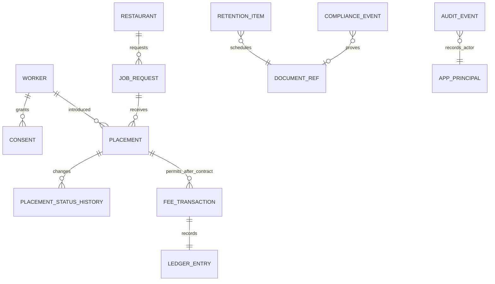
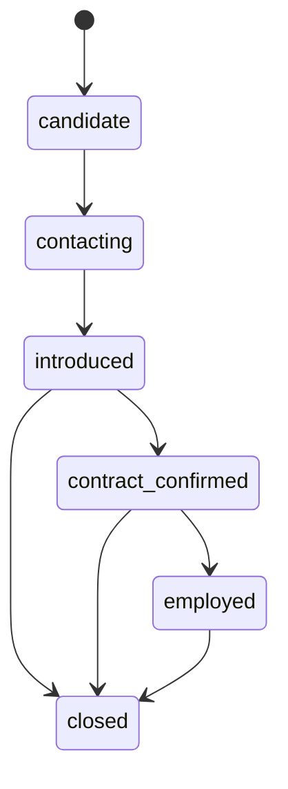

# P0 데이터 사전과 보존 기준 (Mock v1)

> 기준일: 2026-07-16. 실제 개인정보를 넣지 않고 전화·방문 접수 흐름을 검증하기 위한 설계다. 실제 운영 전 개인정보 처리방침, 동의문, 법정 서식 및 동작구 안내와 다시 대조한다.

## 핵심 엔터티

| 엔터티 | 목적 | 주요 필드 | 개인정보 등급 | Mock 보존 규칙 |
|---|---|---|---|---|
| `Restaurant` | 식당 신원·검증 | 상호, 대표자, 전화, 사업자번호, 허가번호, 주소, 검증상태 | 연락처·사업자정보 | 일반 접수 1년, 법정 장부 편입 시 완료일부터 2년 |
| `Worker` | 구직 상담·연락 | 가명, 전화, 생년월일, 희망직종, 가능일, 지역, 희망임금 | 개인정보 | 일반 접수 1년, 법정 장부 편입 시 완료일부터 2년 |
| `JobRequest` | 구인조건 | 직종, 인원, 기간, 시간, 휴게, 임금, 지급일·방법, 근무지 | 사업장 운영정보 | 구인대장으로 완료일부터 2년 |
| `Placement` | 소개·취업 결과 | 구인번호, 근로자번호, 상태, 계약·취업 확인일 | 개인정보 결합 | 소개대장으로 완료일부터 2년 |
| `Consent` | 목적별 동의 증빙 | 수집·이용, 식당 제공, 선택정보, 문서 버전, 철회일 | 동의 증빙 | 관련 처리 종료·법정 보존 기준에 맞춤 |
| `FeeTransaction` | 소개요금 검증 | 납부자, 금액, 상한, 규칙 버전, 청구일 | 거래정보 | 금전 장부로 완료일부터 2년 |
| `LedgerEntry` | 금전 장부 | 유형, 금액, 발생일, 기록자, 보존만료일 | 거래정보 | 발생·완료일부터 2년 |
| `ComplianceEvent` | 신고·교육·점검 일정 | 발생일, 기한, 상태, 증빙명, 규칙 버전 | 내부 관리 | 증빙별 법정·업무 기준 확정 필요 |
| `DocumentRef` | 원본 위치 참조 | 분류, 암호화된 저장키, 접근등급, 파기일 | 고위험 메타정보 | 원본별 기준 |
| `AuditEvent` | 누가 무엇을 했는지 증명 | 행위자, 행동, 대상, 시각, 결과코드, 연결 서명 | 보안 로그 | 운영 정책 확정 필요, 원문 개인정보 저장 금지 |
| `RetentionItem` | 만료·보류·파기 | 자료종류, 만료일, 법적보류, 파기상태 | 내부 관리 | 만료 후 승인·증빙을 남기고 파기 |

## 기본적으로 받지 않는 정보

- 주민등록번호
- 신분증 원본·사본
- 건강진단의 상세 결과나 진단 내용
- 매칭에 필요하지 않은 가족관계·종교·정치성향
- 사유가 확인되지 않은 성별·연령 조건

식품취급 업무의 보건증은 원문을 저장하지 않고 `확인 상태`, `확인일`, `만료일`만 기록한다. 외국인의 경우 실제 취업 가능 여부 확인에 필요한 체류자격 항목만 별도 접근권한 아래 다룬다.

## 상태 전이

`FeeTransaction`과 소개요금 `LedgerEntry`는 `contract_confirmed` 또는 `employed` 상태에서만 생성한다. 모든 상태 변경은 추가 전용 `PlacementStatusHistory`와 감사로그에 남긴다.

## 구현 위치

- 입력 허용목록·검증: `packages/contracts/operations.js`
- 일정·보존 계산: `packages/compliance/rules.js`
- D1 구조: `apps/ops-app/migrations/0001_security_foundation.sql`, `0003_operations_core.sql`
- 내부 API: `apps/ops-app/src/index.js`, `apps/ops-app/src/operations.js`
- 합성 사례: `mock-documents/mock-p0-intake-pack.json`
