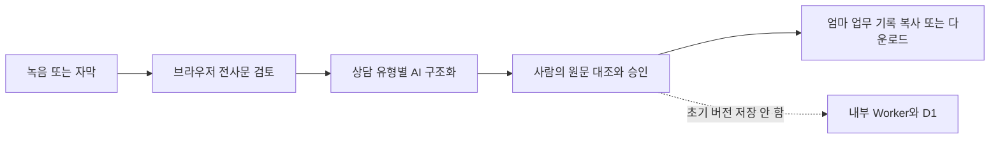

# AI Harness 회의록 → 엄마 업무 기록 기획

## 목표

AI Harness의 `녹음·자막 파일로 회의록 만들기` 입력 화면을 재사용해, 일반 회의록이 아니라
구직자 상담과 식당 사장님 구인 상담의 후속 업무를 빠뜨리지 않는 **검토용 업무 기록 초안**을 만든다.
AI 결과는 사실 확정이나 자동 저장이 아니며, 담당자가 원문과 대조하고 승인한 뒤에만 내부 기록으로 옮긴다.

## 현재 화면에서 재사용할 것

- 브라우저 녹음 시작·종료와 녹음 시간
- 클로바노트 웹 연결
- VTT/SRT/TXT/오디오 파일 선택과 수정 가능한 전사문
- 필수 날짜, 선택 시간·참석자·회의 주제
- AI 요약 후 미리보기와 다운로드

`회의 주제 (선택)`은 사용자에게 보이는 이름을 `제목 (선택)`으로 단순화하고, 비어 있으면
`YYYY-MM-DD 구직자 상담` 또는 `YYYY-MM-DD 식당 구인 상담`으로 자동 생성한다.

## 제안 사용자 흐름

1. `구직자 상담` 또는 `식당 사장님 구인 상담`을 먼저 선택한다.
2. 참여자 모두의 녹음·전사 동의를 체크한다. 미동의 시 녹음·클로바·파일 업로드는 잠그고 수기 메모만 허용한다.
3. 직접 녹음하거나 클로바에서 전사한 자막을 불러온다. 클로바에 남은 원본·녹취 삭제 안내를 보여준다.
4. 날짜를 확인하고 제목은 필요할 때만 입력한다. 원문에서 추정한 이름·전화번호·주소·생년월일은 자동 마스킹 후보로 표시한다.
5. `AI 요약 → 엄마 업무 기록 초안`을 실행한다.
6. 담당자가 원문 대조 체크리스트를 통과시킨 뒤 복사·다운로드한다. 초기 버전은 D1 자동 저장을 하지 않는다.

## 상담 유형별 결과 계약

### 공통

- 한 줄 요약
- 확인된 사실: 원문 근거가 있는 항목만
- 다시 물어볼 것: 누락·모순·불명확 항목
- 동의·안전 경고: 녹음 동의, 제3자 제공, 금지정보, 미성년·건강정보 등
- 다음 할 일: 담당자, 기한, 상태(`대기/진행/완료`)
- 기록 메타데이터: 날짜, 선택 제목, 상담 유형, 생성 시각, 원문 해시

### 구직자 상담

- 희망 직종·가능 날짜/시간·지역·희망임금
- 보건증은 보유/만료/미확인 상태만, 질병명은 기록 금지
- 만 18세 미만이면 친권자·후견인 취업동의 확인 필요 표시
- 식당 제공 동의 전에는 후보 정보를 외부 전달할 다음 할 일 생성 금지

### 식당 사장님 구인 상담

- 업종·근무지·근무일/시간·업무·인원·임금·식사/교통·시작일
- 연령·성별·출신 등 차별 가능 조건은 확정값이 아니라 검토 경고로 분리
- 계약·요금이 확인되기 전 소개요금 청구 또는 금전 장부 생성 금지
- 후보에게 다시 확인할 근로조건을 별도 목록으로 생성

## AI 출력 JSON 초안

```json
{
  "recordDate": "2026-07-19",
  "title": "2026-07-19 식당 구인 상담",
  "consultationType": "restaurant",
  "summary": "합성 요약",
  "confirmedFacts": [{ "field": "workDate", "value": "확인된 값", "evidence": "원문 위치" }],
  "followUpQuestions": ["확인이 필요한 질문"],
  "warnings": [{ "code": "CONSENT_REQUIRED", "message": "식당 제공 동의 확인 필요" }],
  "tasks": [{ "text": "다음 할 일", "owner": "미정", "dueDate": null, "status": "대기" }],
  "source": { "kind": "vtt", "sha256": "원문 해시", "stored": false }
}
```

`evidence`는 긴 원문 복사가 아니라 타임스탬프 또는 줄 번호만 저장한다. 모델이 모르는 값은 `미정`으로 두며 추정으로 채우지 않는다.

## 화면 구성

| 단계 | 필드·동작 | 필수 여부 | 안전장치 |
|---|---|---|---|
| 1 유형 | 구직자 / 식당 | 필수 | 선택에 따라 질문·출력 계약 고정 |
| 2 동의 | 녹음·전사 동의 | 녹음 사용 시 필수 | 해제 즉시 진행 녹음 폐기 |
| 3 원문 | 녹음 / 클로바 / 파일 / 수기 | 하나 필수 | 로컬 우선, 외부 저장 고지 |
| 4 메타 | 날짜 / 제목 | 날짜만 필수 | 제목 자동 생성 |
| 5 요약 | 엄마 업무 기록 초안 생성 | 필수 | 개인정보 후보 마스킹, 예산 표시 |
| 6 검토 | 원문 대조 / 동의 / 금지정보 / 다음 할 일 | 필수 | 전부 확인 전 내보내기 잠금 |

## 시스템 경계



- 초기 버전은 녹음·전사문을 `mom-asked-ops` Worker, D1, R2에 자동 전송·저장하지 않는다.
- AI 호출이 필요하면 Access 뒤의 서버 프록시에서 수행하고, 요청 로그에 원문을 남기지 않는다.
- 클로바 연결은 링크와 자막 가져오기 범위로 한정한다. 계정 자동 로그인, 녹취 자동 수집, 원본 자동 삭제를 약속하지 않는다.
- D1 저장은 동의문 승인, 보존기간, 역할 권한, 삭제·감사 정책이 확정된 후 별도 P1 게이트로 연다.

## 구현 순서와 인수 조건

1. **P0.5 로컬 초안**: 상담 유형·동의 게이트·날짜·선택 제목·구조화 결과·복사/다운로드. 합성 전사문 테스트 통과.
2. **P1 AI Harness 연결**: 현재 `/feature/`의 입력을 위 JSON 계약으로 변환. 원문 근거 없는 값은 생성하지 않는 계약 테스트.
3. **P1 현장 검증**: 비식별 상담 3건에서 누락 질문과 다음 할 일을 담당자가 승인. 실제 개인정보는 테스트에 사용하지 않음.
4. **P1 내부 저장 검토**: 동의문·보존·RBAC·감사·파기 승인 후에만 D1 저장 여부 결정.

완료 기준은 녹음 성공만이 아니다. 구직자/식당 합성 사례 각각에서 동의 차단, 제목 자동 생성, 날짜 유지,
누락 질문, 금지정보 경고, 다음 할 일, 원문 해시, 승인 전 내보내기 차단을 자동 테스트하고 브라우저에서 확인해야 한다.
