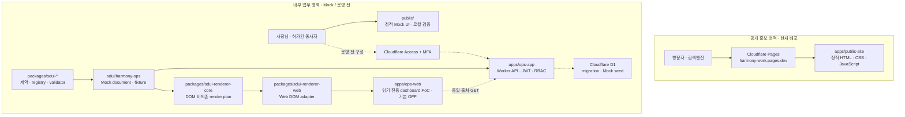
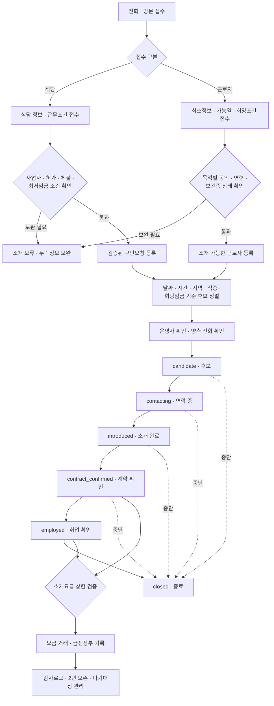
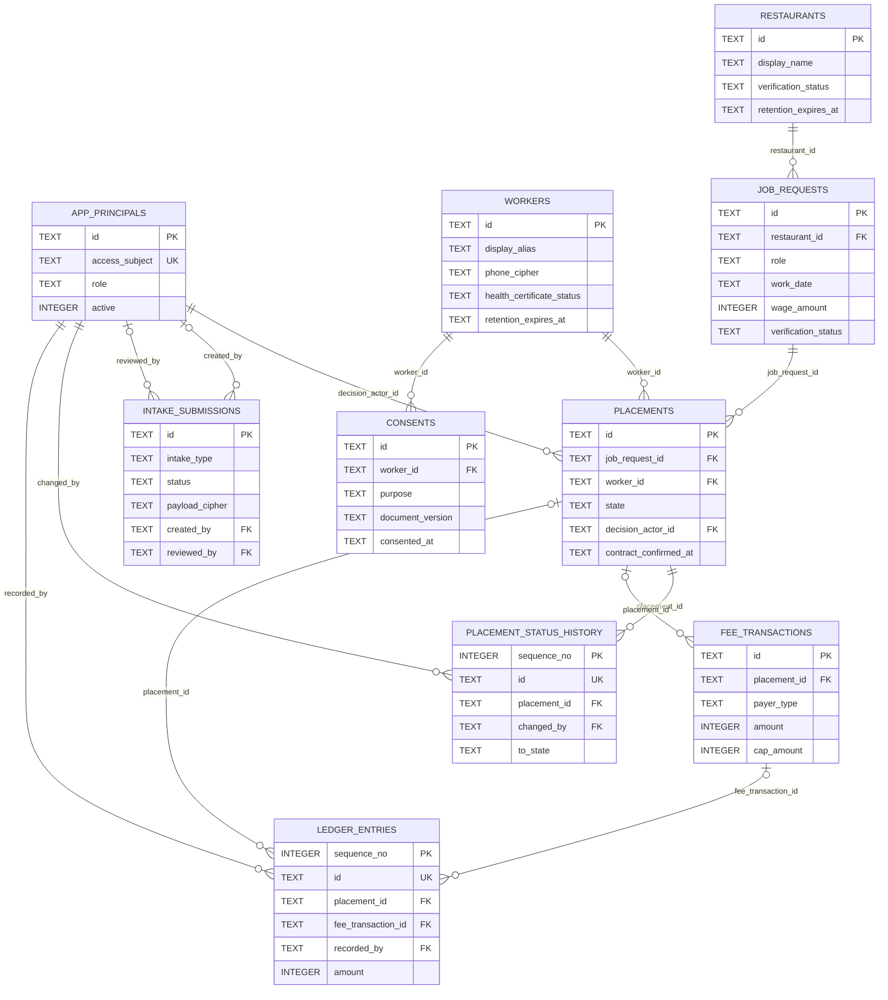
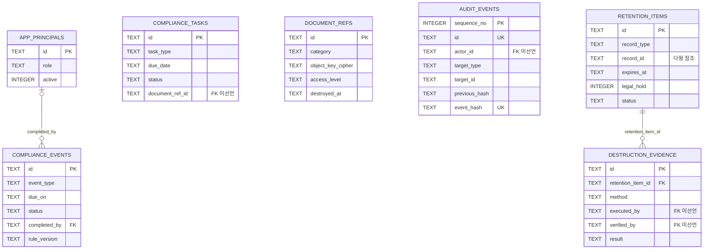

# 하모니직업소개소 디지털 전환 MVP

하모니직업소개소의 공개 홍보페이지와 내부 업무 전산화를 **실제 개인정보 없이** 검증하는 Mock 우선 프로젝트입니다.

- 공개 홍보페이지: [https://harmony-work.pages.dev/](https://harmony-work.pages.dev/)
- 공개 배포: Cloudflare Pages 프로젝트 `harmony-work`
- 내부 업무: 정적 Mock UI·`ops-web` 번들을 Cloudflare Access(이메일 코드 + TOTP) 뒤 비공개 Worker 로 배포, SDUI API 는 staging Worker 에서 fail-closed 검증 중, 운영(실데이터) 전환은 차단 상태
- 데이터 원칙: 합성 Mock 데이터만 사용, `DATA_MODE=mock`, `INTAKE_ENABLED=false`

## 페이지별 배포 URL

| 구분 | 페이지·리소스 | 운영 URL | 상태 |
|---|---|---|---|
| 공개 페이지 | 홈 | [https://harmony-work.pages.dev/](https://harmony-work.pages.dev/) | 운영 중 · HTTP 200 |
| 공개 페이지 | 개인정보 안내 | [https://harmony-work.pages.dev/privacy](https://harmony-work.pages.dev/privacy) | 운영 중 · HTTP 200 |
| 공개 페이지 | 404 안내 | `https://harmony-work.pages.dev/<없는-경로>` | 없는 경로에서 전용 안내와 HTTP 404 반환 |
| 검색 지원 | robots.txt | [https://harmony-work.pages.dev/robots.txt](https://harmony-work.pages.dev/robots.txt) | 운영 중 |
| 검색 지원 | sitemap.xml | [https://harmony-work.pages.dev/sitemap.xml](https://harmony-work.pages.dev/sitemap.xml) | 운영 중 |
| 공유 이미지 | Open Graph 이미지 | [https://harmony-work.pages.dev/og.png](https://harmony-work.pages.dev/og.png) | 운영 중 · 1200×630 PNG |
| 내부 화면 | 정적 Mock UI + `ops-web` 번들 | 비공개 · Cloudflare Access 허용 계정만 (`wrangler.site.jsonc` 로 재배포) | 배포됨 · 합성 Mock 데이터만 제공 |
| 내부 화면 | 읽기 전용 SDUI dashboard PoC | 로컬 `http://127.0.0.1:4175/` | 배포 번들 기본 OFF · 합성 Mock 미리보기만 제공 |

> 운영 URL 확인일: 2026-07-19 (Asia/Seoul). 내부 화면은 Cloudflare Access(이메일 코드 + TOTP) 뒤에만 배포하며 공개 URL 로 노출하지 않습니다.


## 구현 범위

- 명함 색상 기반의 모바일 공개 홍보페이지와 전화 연결
- 식당 구인 검증, 근로자 최소정보 접수, 조건 기반 후보 추천
- 소개 상태 이력과 계약 확인 전 소개요금 청구 차단
- Mock 금전출납부, PDF 인쇄, 장부별 Excel(`.xlsx`) 내보내기
- AI Harness 회의록 입력을 구직자·식당 상담의 검토용 업무 기록으로 바꾸는 [연결 기획](docs/roadmap/mom-work-ai-meeting-record-plan.md)
- 변경등록·보험·교육·점검 준법 캘린더와 Mock 문서함
- Cloudflare Access JWT 재검증, 역할별 권한, 필드 암호화, 감사로그, 보존·파기 기반
- 웹과 향후 모바일 앱이 공유할 SDUI v1 계약·검증기·Mock 문서·Worker page/data/action API
- GitHub Actions 기반 P0 게이트, lint, build, 전체 테스트

## 시스템 구성도

실선은 현재 저장소에서 바로 확인할 수 있는 경로이고, 점선은 운영 Cloudflare 설정 또는 다음 개발 단계가 필요한 경로입니다. 공개 홍보페이지와 내부 업무 시스템은 서로 다른 배포 단위이며 공개페이지에서 내부 API를 연결하지 않습니다.



| 영역 | 현재 상태 | 운영 전 남은 일 |
|---|---|---|
| 공개 홍보페이지 | Pages 배포 완료, 개인정보 입력 기능 없음, 공개 URL 기반 SEO 자동 검증 적용 | 실제 주소·영업시간 원본 확인, 개인정보 고지 검토 뒤 통계 선택 적용 |
| 내부 정적 UI | 합성 데이터로 업무·출력 검증 가능 | 인증된 SDUI Web 화면으로 점진 교체 |
| 내부 Worker | Access JWT·RBAC·업무 규칙·암호화와 SDUI page/data/action API 코드·테스트 구현 | Access 애플리케이션, MFA, 도메인, 비밀키 설정 |
| D1 | 16개 테이블 migration과 일부 Mock seed 구현 | preview/production D1 생성, 마이그레이션·복구 훈련 |
| SDUI | v1 schema·registry·validator, renderer core·Web adapter, dashboard fixture·역할별 Worker UI API와 `apps/ops-web` 읽기 전용 PoC 구현 | 실제 Access staging 검증, Mobile adapter 구현 |

## 업무 Flow chart

전화·방문 접수부터 소개, 계약 확인, 요금 기록까지의 목표 흐름입니다. AI는 후보 순서와 누락정보를 보조할 수 있지만 최종 소개 결정은 운영자가 합니다.



소개요금은 `contract_confirmed` 또는 `employed` 상태에서만 기록할 수 있습니다. 상태 전이, 계약 전 청구 차단과 요금 상한은 D1 제약이 아니라 Worker의 애플리케이션 규칙으로 다시 검증합니다.

## ERD

아래 ERD는 [`0001_security_foundation.sql`](apps/ops-app/migrations/0001_security_foundation.sql)과 [`0003_operations_core.sql`](apps/ops-app/migrations/0003_operations_core.sql)에 선언된 실제 외래키만 연결했습니다. 읽기 쉽도록 핵심 컬럼만 표시하며 전체 컬럼과 인덱스는 migration을 기준으로 합니다.

### 접수·소개·요금



### 준법·감사·보존



ERD 해석 시 다음 제약을 함께 봐야 합니다.

- `intake_submissions`는 접수 결과인 식당·근로자 레코드와 직접 연결된 외래키가 없습니다.
- `compliance_tasks.document_ref_id`, `audit_events.actor_id`, 보존대상의 다형 참조는 현재 논리 참조이며 외래키가 아닙니다.
- `fee_transactions`와 `ledger_entries`는 현재 DB에서 1:1이 아니라 0:N이 가능합니다.
- `audit_events`와 `placement_status_history`는 UPDATE·DELETE 차단 트리거가 있는 추가전용 기록입니다.
- 운영 D1은 아직 생성되지 않았으며 현재 schema와 seed는 Mock 검증용입니다.

## 기술 스택

| 계층 | 기술 | 저장소 기준 상태 |
|---|---|---|
| 언어·런타임 | JavaScript ESM, Node.js `>=22.13` | 현재 사용 |
| 공개 프런트엔드 | HTML5, CSS3, Vanilla JavaScript | 현재 사용 |
| 공개 호스팅 | Cloudflare Pages | `harmony-work` 배포 완료 |
| 내부 Mock UI | HTML, CSS, Vanilla JavaScript, 정적 Worker 빌드 | 로컬·교육용 Mock |
| 내부 API | Cloudflare Workers Fetch API, ESM | 코드·단위 테스트 구현, 운영 배포 차단 |
| 인증·권한 | Cloudflare Access JWT RS256 재검증, `owner`/`staff`/`system_admin` RBAC | 코드 구현, 실제 Access·MFA 미설정 |
| 데이터베이스 | Cloudflare D1(SQLite), SQL migration, Mock seed | schema 구현, 원격 D1 미설정 |
| 암호화·무결성 | Web Crypto API, AES-256-GCM, HMAC-SHA-256, SHA-256 연결값 | 코드·테스트 구현, 운영 키·교체 절차 미설정 |
| 보안 헤더 | CSP, `Cache-Control: no-store`, 내부 `noindex, nofollow` | 구현 |
| SDUI | JSON Schema 2020-12, Ajv 8.18, esbuild 0.28, custom registry·runtime validator·render plan·Web DOM adapter | 계약·fixture·renderer·역할 pruning·ETag·Worker UI API·읽기 전용 Web PoC 구현, P0에서는 비활성 |
| 입력 보호 | 허용 필드 계약, 금지 개인정보 검사, Turnstile 서버 검증 모듈 | 전화·방문 Mock 구현, 공개 온라인 접수 비활성 |
| 문서 출력 | 브라우저 인쇄 PDF, 자체 Excel OOXML(`.xlsx`) 생성 | Mock 장부 구현 |
| 테스트 | Node.js test runner, custom lint, P0 readiness gate | 전체 145개·SDUI 60개·ops-web 7개·SEO 11개 테스트 통과 기준 |
| CI | GitHub Actions, Node 22, `npm ci` | main·PR·`codex/**`에서 lint·P0·Worker 번들·SDUI·ops-web·SEO·전체 회귀 검증 |

### SEO·무료 통계

| 항목 | 현재 | 다음 단계 |
|---|---|---|
| 검색 노출 경계 | 공개 사이트만 검색 허용, 내부 UI·Worker와 404는 `noindex`; CI에서 경계 회귀 검증 | 경계 회귀 테스트 유지 |
| 기본 메타데이터 | 페이지별 title·description·canonical·Open Graph, 빌드 생성 `robots.txt`·sitemap, 검증된 최소 필드의 `LocalBusiness` JSON-LD | [원본 확인 체크리스트](docs/operations/public-business-profile-checklist.md)를 통과한 주소·영업시간만 추가 |
| 방문 통계 | 미적용 | 개인정보 고지와 CSP 검토 뒤 공개 도메인에 GA4 또는 Cloudflare Web Analytics 선택 적용 |
| 내부 업무 통계 | 외부 분석 스크립트 없음 | 계속 미적용, 필요한 운영 지표는 내부 감사·집계로 처리 |

## 저장소 구조

| 경로 | 역할 |
|---|---|
| `apps/public-site` | Cloudflare Pages용 공개 홍보페이지 |
| `public` | 현재 내부 업무 정적 Mock UI와 합성 데이터 |
| `apps/ops-app` | Access·RBAC·D1·암호화·감사·보존과 SDUI API를 담당할 내부 Worker |
| `apps/ops-web` | 기본 OFF인 읽기 전용 SDUI dashboard PoC와 기존 `/admin#dashboard` 대체 경로 |
| `packages/contracts` | 식당·근로자 접수와 업무 입력 계약 |
| `packages/compliance` | 준법기한 계산 규칙 |
| `packages/validation` | Turnstile 등 공통 검증 |
| `packages/sdui-*` | SDUI 계약·Action·테스트 도구 |
| `sdui/harmony-ops` | 하모니 내부 업무 SDUI manifest·theme·Mock document·fixture |
| `docs` | ADR, 데이터 사전, 운영·준법·보안·배포 문서 |
| `tests` | 빌드·업무·보안·내보내기·SDUI 회귀 테스트 |

## 로컬 실행

Node.js 22 이상이 필요합니다. 처음 실행할 때 잠금파일 기준으로 Ajv 등 개발 의존성을 설치합니다.

```powershell
npm.cmd ci
```

내부 정적 Mock UI:

```powershell
npm.cmd run dev -- 4187
```

브라우저에서 `http://127.0.0.1:4187`을 엽니다.

공개 홍보페이지:

```powershell
npm.cmd run dev:public -- 4188
```

Cloudflare Pages의 빌드 명령은 `npm run build:public`, 출력 폴더는 `dist/public-site`입니다. 운영 빌드에서는 `PUBLIC_SITE_URL`을 공개 HTTPS origin(기본값 `https://harmony-work.pages.dev`)으로 설정하며, 이 값으로 canonical·Open Graph·JSON-LD·robots·sitemap을 함께 생성합니다. 잘못된 주소나 `workers.dev` 주소는 빌드 단계에서 거부합니다.

읽기 전용 SDUI dashboard 합성 미리보기:

```powershell
npm.cmd run dev:ops-web
```

브라우저에서 `http://127.0.0.1:4175/`를 엽니다. 이 로컬 서버에는 Cloudflare Access가 적용되지 않으며 실제 데이터나 계정을 사용하지 않습니다. 기본 `npm.cmd run build:ops-web` 산출물은 SDUI가 꺼져 있고 기존 `/admin#dashboard` 링크만 제공합니다.

## 검증

```powershell
npm.cmd run lint
npm.cmd run check:p0
npm.cmd run check:worker
npm.cmd run test:sdui
npm.cmd run test:ops-web
npm.cmd run test:seo
npm.cmd test
```

## 중요한 제한

- 기존 내부 화면(`public`)은 교육용 정적 Mock이라 인증과 영구저장이 없습니다.
- 내부 Worker는 Access·앱 권한·D1 중 하나라도 빠지면 닫힌 상태로 실패합니다.
- 모든 이름·전화·식당·문서·금액은 합성 예시입니다.
- 운영시간과 휴무일은 아직 확인되지 않아 전화 문의로 안내합니다.
- Mock 문서는 실제 제출이나 사업 증빙으로 사용할 수 없습니다.
- 운영 전 #4~#9의 현장·법무·개인정보·보안 게이트를 완료해야 합니다.

설계 결정은 [`docs/adr`](docs/adr), 데이터 사전은 [`docs/data`](docs/data), 전화·방문 표준은 [`docs/operations`](docs/operations), 준법 매핑은 [`docs/compliance`](docs/compliance), 보안 전환 조건은 [`docs/runbooks`](docs/runbooks), P0 진행표는 [`docs/roadmap/p0-progress.md`](docs/roadmap/p0-progress.md)에서 확인할 수 있습니다.
